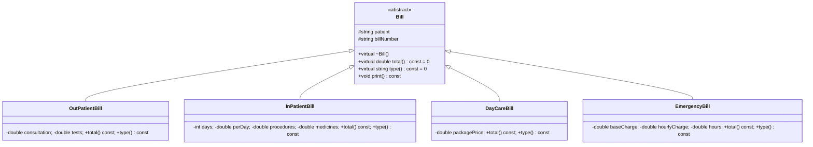

# A1 – Design the Polymorphic Bill Hierarchy (7 marks)

## A1.1 Common interface
Every bill should provide `total() const` (calculate amount), `type() const` (identify category), and `print() const` (display details). Common data can include patient name/ID, bill number and date. Store shared identity data in the base class; keep charge details in derived classes.

## A1.2 Hierarchy and UML
`Bill` is abstract because `total()` and `type()` are pure virtual. The virtual destructor permits safe deletion through `Bill*`. `print()` can be non-virtual and call the virtual functions.


`total()` and `type()` are pure virtual in `Bill` and overridden in each concrete class. `~Bill()` is virtual. `print()` is inherited.

## A1.3 Pseudocode
```text
ALGORITHM CalculateDailyTotal
INPUT: bills, an array of n Bill references/pointers
BEGIN
  dailyTotal <- 0
  FOR i <- 0 TO n-1 DO
    IF bills[i] is not NULL THEN
      bills[i].print()
      dailyTotal <- dailyTotal + bills[i].total()
    END IF
  END FOR
  DISPLAY dailyTotal
END
```

## Alternative and complexity
A single `Bill` record could have a `type` field and a `switch` in `total()`. Both designs total n bills in O(n) time; each bill requires one calculation/dispatch. The tagged record may reserve fields for multiple categories; a polymorphic object stores its relevant fields and commonly a vptr. Both store n bills in O(n) space, with O(1) extra accumulator space. Adding a type requires editing the central switch and record; polymorphism allows a new derived class without changing the processing loop. Polymorphism is preferable when types frequently expand; switch may be simpler for a small fixed set.
